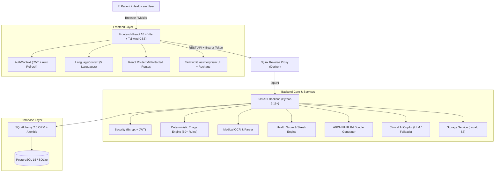

# Maruthuvam.AI – Full-Stack AI Health Copilot 🩺

[](https://fastapi.tiangolo.com)
[](https://react.dev)
[](https://vitejs.dev)
[](https://tailwindcss.com)
[](https://www.postgresql.org)
[](https://www.sqlalchemy.org)
[](https://pytest.org)

> **Understand · Organize · Manage Your Health Journey**  
> Complete enterprise-grade full-stack migration of the Maruthuvam.AI web application built with React, FastAPI, SQLAlchemy 2.0, PostgreSQL/SQLite, and Docker Compose.
## 🌐 Live Demo
https://maruthuvam-ai.vercel.app

**Demo login:** `demo_user` / `demo1234`
---

## 🌟 Key Highlights & Capabilities

- **Multilingual Support (5 Languages):** Full native localization for **English, Tamil (தமிழ்), Tanglish, Hindi (हिन्दी), and Telugu (తెలుగు)** with one-click switcher.
- **Glassmorphism Medical UI:** Modern pink-rose-lavender palette, animated ECG line, floating pill particles, responsive health score progress ring, and Recharts wellness analytics.
- **JWT Authentication & Security:** Argon2 / Bcrypt password hashing, JWT access tokens, refresh token rotation, strict per-user database isolation, and role-based access.
- **Transparent Health Score & BMI:** Real-time formula calculating wellness progress across 4 pillars (Water, Sleep, Steps, Mood) without pseudo-clinical claims.
- **Daily Health Logging:** Multi-metric daily tracking with prevention of accidental duplicates, streak counting, and historical range filtering.
- **Deterministic 50+ Rule Triage Engine:** Safety-first clinical triage matrix separating urgent red flags (Chest Pain, Stroke signs, Severe Bleeding) from general advice, with one-tap dialing to Indian emergency numbers (`108` Ambulance, `112` National Helpline, `102` Pregnancy, `104` Health info, `14416` Tele-MANAS).
- **Medical Records & AI OCR Pipeline:** Multi-format document upload (PDF, JPG, PNG) with simulated/Tesseract OCR extraction, diagnosis parsing, lab reference range extraction, confidence scores, and mandatory patient review modal.
- **ABDM & FHIR R4 Collection Bundle:** One-click generation and JSON download of Ayushman Bharat Digital Mission (ABDM) compliant FHIR R4 bundles (Patient, Condition, MedicationRequest, Observation, DiagnosticReport, Composition), plus simulated ABHA ID linking (`91-XXXX-XXXX-XXXX`).
- **Interactive Care Hub & Telehealth:** Dedicated modules for BP/SpO2/Glucose logs with hypertensive crisis triggers, calorie tracker, caregiver management, and encrypted WebRTC video room launcher.
- **Live OpenStreetMap Healthcare Finder:** Real-time GPS/pincode locator querying Overpass API for nearby hospitals, clinics, and pharmacies with Haversine distance and directions links.
- **Conversational Voice Assistant:** In-app floating health assistant with Web Speech API recognition (mic) and SpeechSynthesis text-to-speech.

---

## 🏗️ System Architecture



---

## 📂 Project Directory Structure

```text
hackathon/
├── backend/
│   ├── alembic/                      # Database migrations
│   │   ├── versions/
│   │   │   └── 0001_initial_schema.py
│   │   └── env.py
│   ├── app/
│   │   ├── api/v1/                   # REST API v1 Routers
│   │   │   ├── appointments.py
│   │   │   ├── auth.py
│   │   │   ├── chat.py
│   │   │   ├── dashboard.py
│   │   │   ├── fhir.py
│   │   │   ├── health_logs.py
│   │   │   ├── healthcare_finder.py
│   │   │   ├── medical_records.py
│   │   │   ├── medications.py
│   │   │   ├── triage.py
│   │   │   ├── users.py
│   │   │   └── vitals.py
│   │   ├── core/                     # Configuration, Security, Logging
│   │   │   ├── config.py
│   │   │   ├── logging.py
│   │   │   └── security.py
│   │   ├── db/                       # Engine, Sessions, Declarative Base
│   │   │   ├── base.py
│   │   │   └── session.py
│   │   ├── models/                   # SQLAlchemy 2.0 Models
│   │   │   ├── appointment.py
│   │   │   ├── audit.py
│   │   │   ├── chat.py
│   │   │   ├── health_log.py
│   │   │   ├── medical_record.py
│   │   │   ├── medication.py
│   │   │   ├── user.py
│   │   │   └── vitals.py
│   │   ├── schemas/                  # Pydantic v2 Request/Response Schemas
│   │   ├── services/                 # Business Logic Services
│   │   │   ├── ai_service.py
│   │   │   ├── fhir_service.py
│   │   │   ├── health_service.py
│   │   │   ├── location_service.py
│   │   │   ├── ocr_service.py
│   │   │   ├── storage_service.py
│   │   │   └── triage_service.py
│   │   └── main.py                   # FastAPI application entry point
│   ├── tests/                        # Automated Pytest Suite (13 tests)
│   ├── Dockerfile                    # Production backend container definition
│   ├── requirements.txt              # Pinned Python package dependencies
│   ├── seed.py                       # Realistic demonstration database seeder
│   └── alembic.ini                   # Alembic migration configuration
├── frontend/
│   ├── src/
│   │   ├── api/                      # Axios centralized HTTP client & services
│   │   ├── components/               # Modular Accessible React UI Components
│   │   │   ├── chat/                 # Chat window, quick prompts, voice recognition
│   │   │   ├── common/               # ECG line, health score ring, pills, guards
│   │   │   ├── dashboard/            # Hero, metric cards, BMI calc, weekly chart
│   │   │   ├── layout/               # Sticky header, emergency SOS footer, layout
│   │   │   ├── records/              # Smart OCR modal, record card, lab trends
│   │   │   └── triage/               # Red-flag symptom form, emergency modal
│   │   ├── context/                  # AuthContext & LanguageContext
│   │   ├── i18n/                     # Translations (English, Tamil, Tanglish, Hindi, Telugu)
│   │   ├── pages/                    # 13 Application views
│   │   ├── styles/                   # Tailwind CSS & animations
│   │   ├── tests/                    # Vitest unit test suite (9 tests)
│   │   ├── App.jsx                   # Root application wrapper
│   │   ├── main.jsx                  # React DOM mount point
│   │   └── router.jsx                # React Router v6 route configuration
│   ├── Dockerfile                    # Multi-stage production frontend Dockerfile
│   ├── nginx.conf                    # Nginx reverse proxy configuration
│   ├── package.json                  # Node.js dependencies & scripts
│   ├── tailwind.config.js            # Tailwind CSS design system config
│   └── vite.config.js                # Vite build tool and proxy setup
├── docker-compose.yml                # Full stack multi-container orchestration
├── .env.example                      # Environment variables reference template
├── .gitignore                        # Git ignore patterns
└── README.md                         # Project documentation and run guide
```

---

## ⚡ Quick Start: Local Development (Windows / macOS / Linux)

### 1. Prerequisites
- **Python:** 3.11, 3.12, 3.13, or 3.14
- **Node.js:** v18, v20, or v22 (npm 10+)
- **Git**

### 2. Backend Setup
1. Open terminal and navigate to the project root:
   ```bash
   cd hackathon
   ```
2. Create and activate a Python virtual environment:
   ```powershell
   # Windows PowerShell
   python -m venv .venv
   .\.venv\Scripts\Activate.ps1

   # macOS / Linux
   python3 -m venv .venv
   source .venv/bin/activate
   ```
3. Install backend dependencies:
   ```bash
   pip install -r backend/requirements.txt
   ```
4. Seed the database with the pre-configured demonstration account and 7-day health history:
   ```powershell
   # Windows PowerShell
   $env:PYTHONPATH = "backend"
   python backend/seed.py

   # macOS / Linux
   export PYTHONPATH=backend
   python backend/seed.py
   ```
5. Start the FastAPI backend server:
   ```powershell
   # Windows PowerShell
   $env:PYTHONPATH = "backend"
   python -m uvicorn app.main:app --app-dir backend --reload --port 8000

   # macOS / Linux
   export PYTHONPATH=backend
   uvicorn app.main:app --app-dir backend --reload --port 8000
   ```
   *The backend will be live at `http://127.0.0.1:8000` with interactive Swagger API docs at `http://127.0.0.1:8000/docs`.*

---

### 3. Frontend Setup
1. In a new terminal window, navigate to `frontend/`:
   ```bash
   cd frontend
   ```
2. Install npm dependencies:
   ```bash
   npm install
   ```
3. Start the Vite development server:
   ```bash
   npm run dev
   ```
   *The frontend will be live at `http://localhost:3000` (or `http://localhost:5173`).*

---

## 🔑 Demonstration Account Credentials

The database comes pre-seeded with a comprehensive test patient profile:

| Username | Password | Profile Details | Pre-loaded Data |
| :--- | :--- | :--- | :--- |
| `demo_user` | `demo1234` | Age 29, 172cm, 68kg (BMI 23.0 - Healthy) | 7 days daily logs, 4 medical records, 2 reminders, 1 appointment, SpO2 & BP vitals |

> *Tip: You can also click the **"Fill Demo Account"** button on the Login page for one-click authentication.*

---

## 🐳 Docker Compose Deployment

To deploy the entire production stack (PostgreSQL 16 + FastAPI + Nginx React Frontend):

1. Ensure Docker Desktop is running.
2. From the project root, run:
   ```bash
   docker compose up --build -d
   ```
3. Check running containers:
   ```bash
   docker compose ps
   ```
4. Access the applications:
   - **Web Application:** `http://localhost:3000`
   - **Backend API & Swagger:** `http://localhost:8000/docs`
   - **PostgreSQL Database:** `localhost:5432` (database: `maruthuvam`, user: `postgres`)

To stop the containers:
```bash
docker compose down
```

---

## 🧪 Automated Testing Suite

The application includes automated test coverage for both backend and frontend layers (22 total tests passing).

### Running Backend Tests (Pytest)
```powershell
# From project root
$env:PYTHONPATH = "backend"
pytest backend/tests -v
```
**Test Coverage Includes:**
- `test_auth.py`: Registration, duplicate username prevention, login, JWT token verification, profile retrieval.
- `test_fhir.py`: ABDM FHIR R4 Collection Bundle generation, ABHA ID linking, and resource import.
- `test_health_logs.py`: Multi-metric daily health logging, duplicate prevention, 7-day dashboard trends.
- `test_medical_records.py`: Record creation, cross-user isolation security, OCR diagnostic parsing.
- `test_triage.py`: Deterministic red-flag emergency detection, non-urgent self-care categorization.

### Running Frontend Tests (Vitest)
```powershell
# From frontend directory
cd frontend
npm test
```
**Test Coverage Includes:**
- `i18n.test.js`: Validates all 5 language dictionaries (English, Tamil, Tanglish, Hindi, Telugu) have 100% key coverage.
- `auth.test.js`: Token persistence, local storage lifecycle, base URL configuration.
- `components.test.jsx`: HealthScoreRing value clamping (0-100) and animated EcgLine SVG dimensions.

---

## 🛡️ Medical Safety & Deterministic Emergency Matrix

Maruthuvam.AI is designed with **Safety-First Clinical Architecture**:
1. **No Hallucinated Emergency Guidance:** Emergency symptom triage is governed by **deterministic clinician-reviewed rules** (over 50 emergency condition patterns). LLMs are never permitted to override emergency categorization.
2. **Immediate Indian Emergency Helpline Directives:**
   - 🚨 **108** – Free Emergency Ambulance Service
   - 🚨 **112** – National Unified Emergency Response
   - 🚨 **102** – Free Maternal & Child Care Ambulance
   - 🚨 **104** – State Health Information Helpline
   - 🚨 **14416** – Tele-MANAS Mental Health Helpline
3. **Medical Disclaimer Notice:** The application clearly labels that it provides informational and organizational assistance and does not formulate clinical diagnoses or replace accredited medical professionals.

---

## 📄 License
MIT License. Built for accessible healthcare technology.
